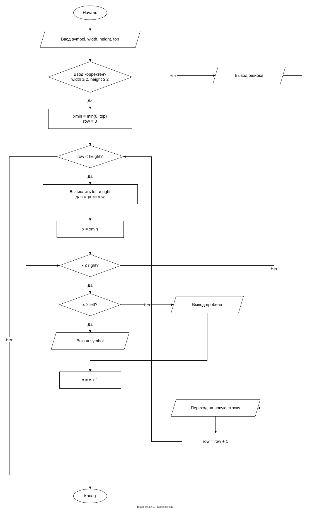

# Практическая работа 9. Вложенные циклы
# Домашнее задание

## Вариант 15

### Условие задачи

Написать программу, которая выводит геометрическую фигуру из домашнего задания к работе № 6 с помощью символа, введённого с клавиатуры. Предусмотреть изменение размеров фигуры пользователем.

В варианте 15 область ограничена двумя наклонными прямыми и осью Ox. Ограниченная область представляет собой треугольник. Программа рисует его с заполнением.

### Блок-схема

[Открыть блок-схему в draw.io](https://app.diagrams.net/?lang=ru#Uhttps%3A%2F%2Fraw.githubusercontent.com%2FDregMenlion%2FLaba9%2Fmaster%2Fflowchart.drawio)

# Информация о разработчике

**Трофимовский Артём**  
Группа: **бОТИ-261**
